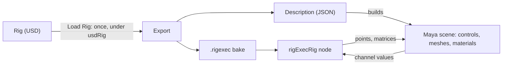

# How it works

The rig runs inside Maya, from a baked copy.

## Loading: the export

Loading a rig runs `rigExecMaya/export/rigexec_maya_export.py` once, under
the usdRig checkout's own Python and USD. It:

- bakes the rig with usdRig's `rigExecBake --poseable` into a `.rigexec`
  file, a version of the rig that can be posed without USD;
- writes a description of the controls, channels, meshes, materials, control
  picker, IK/FK limbs (with their rest offsets) and space switches.

The export can't run inside Maya. Maya ships its own USD (25.11 with MayaUSD
0.37), which has the same library names as usdRig's 26.08 build and an
older OpenExec, so the two can't share a process. The export runs as a child
process with Maya's Python and USD settings kept away from it.

## Animating: the `rigExecRig` node

The `rigExecRig` node (in `plug-ins/rigExecMaya.mll`) plays the bake with
usdRig's runtime, compiled into the plug-in. The runtime links no USD, so it
runs in Maya's own process with nothing else alongside it.

The node reads every control channel and writes three outputs:

- each mesh's deformed points;
- each mesh's world matrix;
- each control's `offsetParentMatrix`. With the control's own
  translate/rotate/scale on top, this lands the control exactly on the frame
  the rig computed.

## The parts

| Part | Where | Does |
| --- | --- | --- |
| `rigExecMaya.mll` | `rigExecMaya/plug-ins` | The `rigExecRig` node, the hover picker's overlay, and the `rigExecCache`, `rigExecFrames` and `rigExecHoverImage` commands |
| Export | `rigExecMaya/export` | Bakes and describes a rig, under usdRig |
| `rigexec_maya` | `rigExecMaya/scripts` | Loading, scene building, the pickers, matching and the RigExec menu |

The pickers load usdRig's picker rules (`pickerModel.py`,
`pickerHoverModel.py`) from the usdRig checkout, so they behave as they do
in usdview.
