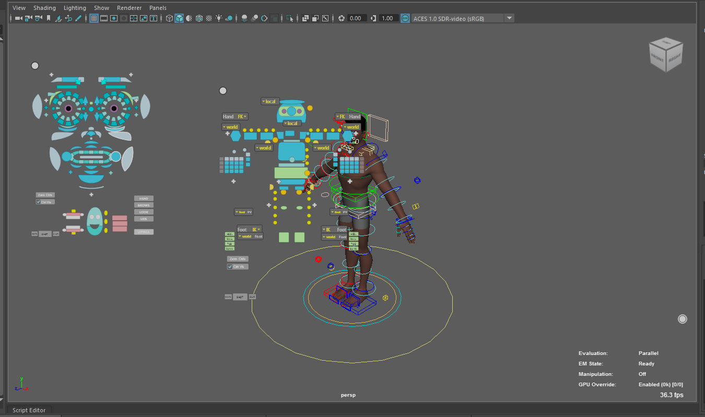

# RigExec for Maya

Animate a [RigExec](https://github.com/n-burk/usdRig) rig in Maya 2027. The
rig stays a USD layer, and nothing is written back to it: Maya holds the
controls and their animation, the rig runs inside Maya, and Maya shows the
deformed meshes.

## What you get

- **Your rig's controls in Maya.** Each control is a Maya transform with its
  shape, posed with Maya's own move, rotate and scale tools, the Channel Box
  and the Graph Editor. Key them on the timeline like any Maya control.
- **Live deformation.** Meshes deform as you pose, with the rig's materials.
- **The rig's own picker,** in a dockable window or floating right in the
  viewport.
- **Matched switches.** Flip a limb between IK and FK, or change a
  control's space, and nothing jumps.
- **Fast playback.** Frames are cached as they play, and background threads
  fill in the rest of the range.
- **Saved scenes reopen** with the rig ready to go.

## Where to start

- **[Install and build](install.md)**: what you need, and how to build the
  plug-in.
- **[Tutorial: the biped](biped-example.md)**: from a fresh checkout to
  animating usdRig's biped character.
- **[Picker](picker.md)** and **[Hover picker](hover-picker.md)**: pick and
  switch controls.
- **[How it works](how-it-works.md)**: what loading a rig does, and where
  the rig runs.

## Requirements at a glance

| | |
| --- | --- |
| Maya | 2027 (Windows) |
| usdRig | A built checkout, beside this repository as `../usdRig` |
| Compiler | Visual Studio 2022, CMake 3.26+, Ninja |
