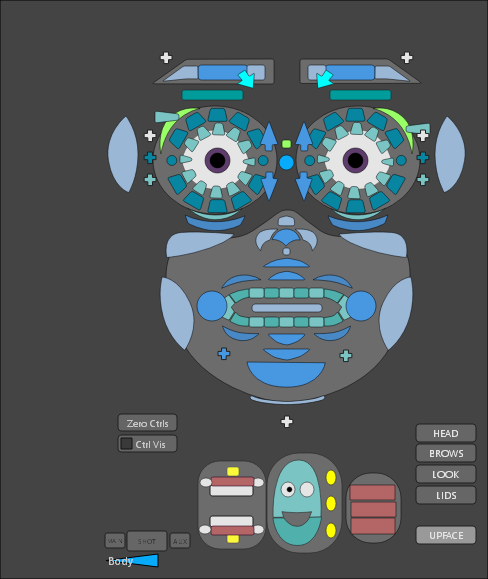
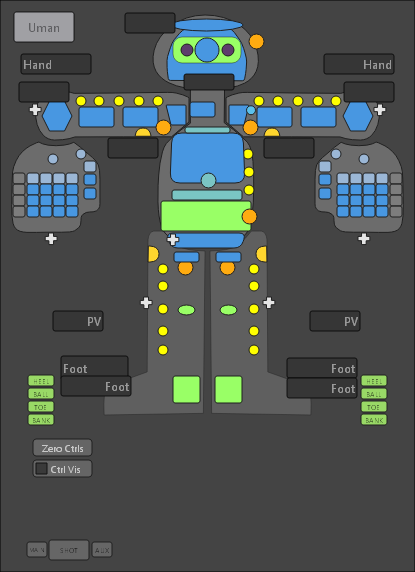

# Picker

**RigExec > Picker** opens the rig's control picker in a dockable window,
with one tab per panel. The biped has two, Face and Body.

{ width="320" }
{ width="280" }

The picker comes from the rig itself: its `RigExecPicker` prims are read
when the rig loads and kept on the `rigExecRig` node, so saved scenes keep
it. It uses usdRig's own picker rules, so it behaves as it does in usdview.

## Selecting

| Gesture | Does |
| --- | --- |
| Click a button | Select its controls |
| Drag a box | Select every control the box touches |
| ++shift++ + click or drag | Toggle those controls in the selection |
| ++ctrl++ + click or drag | Remove them from the selection |
| ++alt++ + click or drag | Bring the mirrored side along |
| ++ctrl+a++ | Select every control on the panel |
| ++f++ | Frame the selection |

Selecting in the viewport highlights the matching buttons.

## Switches

The IK/FK switches flip a limb, and the space switches open a menu of
spaces. Every switch is matched, so the limb or control keeps its place.
See [IK/FK and space switches](switching.md).

The picker shows only the controls of the half of each limb that's active:
an arm in IK shows its IK control and pole, and an arm in FK shows its FK
chain.

## Commands

- **Zero Ctrls** returns the selected controls, or every control when none
  are selected, to the rig's default pose.
- **Ctrl Vis** shows or hides the controls.

## The picker in the viewport

The same buttons can float right in the viewport. See
[Hover picker](hover-picker.md).
